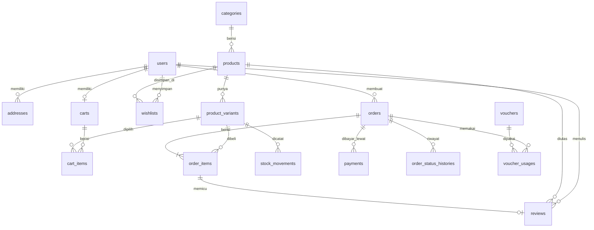

# DB.md — Rancangan Database Toko Online Kerudung (Full Laravel)

> Dokumen pendamping `implementation-plan.md` dan `prompt.md`. Berisi ERD, definisi tabel, indeks, enum, aturan integritas, urutan migrasi, dan contoh migrasi Laravel.

---

## 1. Prinsip Desain

| Prinsip | Keterangan |
|---|---|
| Mata uang | Rupiah disimpan sebagai `unsignedBigInteger` (tanpa desimal), mis. `129000` |
| Primary key | `id` bigIncrements untuk tabel internal; `orders.number` (unik) sebagai ID publik |
| Waktu | `timestamps()` di semua tabel; `softDeletes()` hanya pada `products`, `product_variants`, `categories`, `vouchers` |
| Snapshot | Nama, harga, dan alamat disalin ke `order_items` / `orders` agar riwayat tidak berubah |
| Status | PHP backed Enum (disimpan sebagai string), bukan MySQL ENUM, agar mudah diubah |
| Stok | Kolom `stock` (tersedia) + `reserved` (tertahan order belum bayar); semua perubahan dicatat di `stock_movements` |
| Role | Ditangani paket `spatie/laravel-permission`; tidak ada kolom `role` di `users` |
| Integritas | Foreign key dengan aturan `restrictOnDelete` untuk data transaksi, `cascadeOnDelete` untuk data turunan |
| Database | MySQL 8 / MariaDB atau PostgreSQL; charset `utf8mb4` |

---

## 2. ERD



---

## 3. Definisi Tabel

Legenda: **PK** primary key, **FK** foreign key, **UQ** unique, **IDX** index, **N** nullable.

### 3.1 `users`
Satu tabel untuk admin, staf, dan customer (dibedakan lewat role spatie).

| Kolom | Tipe | Catatan |
|---|---|---|
| id | bigint PK | |
| name | string(120) | |
| email | string(190) UQ | |
| phone | string(20) N, IDX | format 62xxxxxxxxxx |
| email_verified_at | timestamp N | |
| password | string | hash |
| google_id | string N, UQ | login Google (opsional) |
| is_active | boolean | default `true` |
| last_login_at | timestamp N | |
| remember_token | string(100) N | |
| timestamps | | |

### 3.2 `addresses`
| Kolom | Tipe | Catatan |
|---|---|---|
| id | bigint PK | |
| user_id | FK → users | cascade |
| label | string(40) | Rumah, Kantor, dll. |
| recipient_name | string(120) | |
| phone | string(20) | |
| province | string(80) | |
| city | string(80) | |
| district | string(80) | kecamatan |
| postal_code | string(10) | |
| detail | text | jalan, RT/RW, patokan |
| shipping_area_id | string(60) N | ID area dari Biteship/RajaOngkir |
| is_default | boolean | default `false` |
| timestamps | | |

IDX: `(user_id, is_default)`.

### 3.3 `categories`
| Kolom | Tipe | Catatan |
|---|---|---|
| id | bigint PK | |
| name | string(100) | |
| slug | string(120) UQ | |
| description | text N | |
| position | unsignedInt | urutan tampil |
| is_active | boolean | |
| seo_title, seo_description | string N | |
| timestamps, deleted_at | | |

### 3.4 `products`
| Kolom | Tipe | Catatan |
|---|---|---|
| id | bigint PK | |
| category_id | FK → categories | restrict |
| name | string(160) | |
| slug | string(180) UQ | |
| short_description | string(300) N | |
| description | longText N | |
| material | string(80) N | voal, ceruty, satin, paris, dll. |
| size_guide | text N | |
| care_guide | text N | |
| status | string(20) | `draft` / `active` / `archived` |
| is_featured | boolean | |
| sold_count | unsignedInt | default 0, cache untuk "terlaris" |
| rating_avg | decimal(2,1) | default 0 (Fase 2) |
| rating_count | unsignedInt | default 0 (Fase 2) |
| seo_title, seo_description | string N | |
| timestamps, deleted_at | | |

IDX: `(status, category_id)`, `(is_featured)`, FULLTEXT `(name, short_description)` (MySQL) atau `pg_trgm` (PostgreSQL).

### 3.5 `product_variants`
| Kolom | Tipe | Catatan |
|---|---|---|
| id | bigint PK | |
| product_id | FK → products | cascade |
| sku | string(60) UQ | |
| color | string(60) | nama warna |
| color_hex | string(7) N | untuk swatch |
| size | string(40) N | mis. 110×110, All Size |
| price | unsignedBigInt | harga jual |
| compare_price | unsignedBigInt N | harga coret |
| stock | integer | stok tersedia, `CHECK (stock >= 0)` |
| reserved | integer | stok tertahan order pending, `CHECK (reserved >= 0)` |
| weight_gram | unsignedInt | untuk ongkir |
| is_active | boolean | |
| position | unsignedInt | |
| timestamps, deleted_at | | |

UQ: `(product_id, color, size)`. IDX: `(product_id, is_active)`.
Stok yang bisa dijual = `stock - reserved`.

### 3.6 `stock_movements` *(tambahan untuk audit stok)*
| Kolom | Tipe | Catatan |
|---|---|---|
| id | bigint PK | |
| product_variant_id | FK → product_variants | restrict |
| type | string(20) | `reserve`, `release`, `sale`, `adjustment`, `return` |
| quantity | integer | positif/negatif |
| stock_after | integer | |
| order_id | FK N → orders | |
| user_id | FK N → users | admin yang menyesuaikan |
| note | string N | |
| created_at | timestamp | |

IDX: `(product_variant_id, created_at)`.

### 3.7 `carts` & `cart_items`
**carts**

| Kolom | Tipe | Catatan |
|---|---|---|
| id | bigint PK | |
| user_id | FK N → users, UQ | cascade; null untuk guest |
| session_id | string(100) N, IDX | untuk guest |
| timestamps | | |

**cart_items**

| Kolom | Tipe | Catatan |
|---|---|---|
| id | bigint PK | |
| cart_id | FK → carts | cascade |
| product_variant_id | FK → product_variants | cascade |
| quantity | unsignedSmallInt | |
| timestamps | | |

UQ: `(cart_id, product_variant_id)`.

### 3.8 `wishlists`
| Kolom | Tipe | Catatan |
|---|---|---|
| id | bigint PK | |
| user_id | FK → users | cascade |
| product_id | FK → products | cascade |
| created_at | timestamp | |

UQ: `(user_id, product_id)`.

### 3.9 `vouchers` & `voucher_usages`
**vouchers**

| Kolom | Tipe | Catatan |
|---|---|---|
| id | bigint PK | |
| code | string(40) UQ | disimpan uppercase |
| description | string N | |
| type | string(10) | `percent` / `fixed` |
| value | unsignedBigInt | persen (1–100) atau nominal Rp |
| min_purchase | unsignedBigInt | default 0 |
| max_discount | unsignedBigInt N | batas diskon untuk tipe percent |
| quota | unsignedInt N | null = tak terbatas |
| used_count | unsignedInt | default 0 |
| per_user_limit | unsignedSmallInt N | |
| starts_at, ends_at | timestamp N | |
| is_active | boolean | |
| timestamps, deleted_at | | |

**voucher_usages**

| Kolom | Tipe | Catatan |
|---|---|---|
| id | bigint PK | |
| voucher_id | FK → vouchers | restrict |
| order_id | FK → orders | cascade |
| user_id | FK N → users | |
| discount_amount | unsignedBigInt | |
| created_at | timestamp | |

UQ: `(voucher_id, order_id)`.

### 3.10 `orders`
| Kolom | Tipe | Catatan |
|---|---|---|
| id | bigint PK | |
| number | string(30) UQ | mis. `INV-20261016-0001` |
| user_id | FK N → users | null = guest; `nullOnDelete` |
| customer_name | string(120) | snapshot |
| customer_email | string(190) | snapshot |
| customer_phone | string(20) | snapshot |
| shipping_address | json | snapshot alamat lengkap |
| subtotal | unsignedBigInt | |
| discount_total | unsignedBigInt | default 0 |
| shipping_cost | unsignedBigInt | default 0 |
| grand_total | unsignedBigInt | |
| voucher_code | string(40) N | snapshot |
| status | string(20) | `OrderStatus` |
| payment_status | string(20) | `PaymentStatus` |
| courier | string(40) N | jne, jnt, sicepat, dll. |
| courier_service | string(60) N | REG, YES, dll. |
| tracking_number | string(60) N | resi |
| total_weight_gram | unsignedInt | |
| customer_note | text N | |
| internal_note | text N | hanya admin |
| expires_at | timestamp N, IDX | batas bayar |
| paid_at, shipped_at, completed_at, cancelled_at | timestamp N | |
| cancel_reason | string N | |
| timestamps | | |

IDX: `(user_id, created_at)`, `(status, created_at)`, `(payment_status)`, `(customer_email)`, `(customer_phone)`.

### 3.11 `order_items`
| Kolom | Tipe | Catatan |
|---|---|---|
| id | bigint PK | |
| order_id | FK → orders | cascade |
| product_variant_id | FK N → product_variants | `nullOnDelete` |
| product_name | string(160) | snapshot |
| variant_label | string(120) | snapshot, mis. "Dusty Pink / 110×110" |
| sku | string(60) | snapshot |
| price | unsignedBigInt | snapshot harga satuan |
| quantity | unsignedSmallInt | |
| subtotal | unsignedBigInt | price × quantity |
| weight_gram | unsignedInt | snapshot |
| timestamps | | |

### 3.12 `payments`
| Kolom | Tipe | Catatan |
|---|---|---|
| id | bigint PK | |
| order_id | FK → orders | restrict |
| provider | string(20) | `midtrans` / `xendit` |
| provider_ref | string(100) N, IDX | ID transaksi dari gateway |
| method | string(40) N | qris, bca_va, gopay, dll. |
| amount | unsignedBigInt | |
| status | string(20) | `pending`, `paid`, `failed`, `expired`, `refunded` |
| payment_url | text N | link/snap token |
| expires_at | timestamp N | |
| paid_at | timestamp N | |
| raw_payload | json N | payload webhook terakhir |
| timestamps | | |

UQ: `(provider, provider_ref)` untuk menjamin webhook idempotent.

### 3.13 `order_status_histories`
| Kolom | Tipe | Catatan |
|---|---|---|
| id | bigint PK | |
| order_id | FK → orders | cascade |
| from_status, to_status | string(20) | |
| changed_by | FK N → users | null = sistem/webhook |
| note | string N | |
| created_at | timestamp | |

### 3.14 `reviews` *(Fase 2)*
| Kolom | Tipe | Catatan |
|---|---|---|
| id | bigint PK | |
| user_id | FK → users | cascade |
| product_id | FK → products | cascade |
| order_item_id | FK → order_items, UQ | satu ulasan per item pembelian |
| rating | unsignedTinyInt | 1–5 |
| body | text N | |
| is_approved | boolean | moderasi admin |
| timestamps | | |

Foto ulasan disimpan lewat `media` (spatie).

### 3.15 Konten & Pengaturan
**banners**

| Kolom | Tipe |
|---|---|
| id, title, subtitle N, link_url N, position (hero/promo), sort_order, starts_at N, ends_at N, is_active, timestamps | Gambar via `media` |

**pages** (Tentang, FAQ, Retur, S&K, Privasi)

| Kolom | Tipe |
|---|---|
| id, title, slug UQ, body (longText), is_published, seo_title N, seo_description N, timestamps | |

**settings**

| Kolom | Tipe | Catatan |
|---|---|---|
| key | string(80) PK | |
| value | json N | |
| timestamps | | |

Contoh key: `store.name`, `store.whatsapp`, `store.warehouse_address`, `shipping.couriers`, `checkout.guest_enabled`, `order.payment_expiry_hours`, `analytics.ga4_id`, `analytics.meta_pixel_id`.

### 3.16 Tabel dari Paket / Framework
| Tabel | Sumber |
|---|---|
| `roles`, `permissions`, `model_has_roles`, `model_has_permissions`, `role_has_permissions` | spatie/laravel-permission |
| `media` | spatie/laravel-medialibrary |
| `notifications` | Laravel database notifications (opsional) |
| `jobs`, `job_batches`, `failed_jobs` | Queue (jika driver database) |
| `sessions`, `cache`, `cache_locks` | Session/cache driver database (opsional) |
| `password_reset_tokens` | Breeze |
| `activity_log` | spatie/laravel-activitylog (Fase 2) |

---

## 4. Enum

```php
enum OrderStatus: string {
    case PendingPayment = 'pending_payment';
    case Paid           = 'paid';
    case Processing     = 'processing';
    case Shipped        = 'shipped';
    case Completed      = 'completed';
    case Cancelled      = 'cancelled';
    case Expired        = 'expired';
}

enum PaymentStatus: string {
    case Pending  = 'pending';
    case Paid     = 'paid';
    case Failed   = 'failed';
    case Expired  = 'expired';
    case Refunded = 'refunded';
}

enum VoucherType: string {
    case Percent = 'percent';
    case Fixed   = 'fixed';
}

enum ProductStatus: string {
    case Draft = 'draft'; case Active = 'active'; case Archived = 'archived';
}
```

**Transisi status order yang diizinkan**

```
pending_payment → paid | cancelled | expired
paid            → processing | cancelled (refund)
processing      → shipped | cancelled (refund)
shipped         → completed
completed, cancelled, expired → (final)
```

---

## 5. Aturan Integritas & Bisnis di Level Database

1. **Anti oversell:** reservasi stok dilakukan dalam `DB::transaction` dengan `lockForUpdate()` pada baris `product_variants`; tambahkan `CHECK (stock - reserved >= 0)` jika didukung (MySQL 8.0.16+ / PostgreSQL).
2. **Idempotent webhook:** UQ `(provider, provider_ref)` pada `payments`; proses ulang hanya jika status berubah.
3. **Nomor order unik:** `orders.number` UQ; generate di server dengan retry saat bentrok.
4. **Voucher:** naikkan `used_count` secara atomik (`UPDATE ... WHERE used_count < quota`) dan catat di `voucher_usages`.
5. **Satu alamat default per user:** dijaga di level aplikasi (set `is_default=false` pada alamat lain dalam transaksi).
6. **Data transaksi tidak dihapus:** produk/varian memakai soft delete; `order_items` menyimpan snapshot sehingga riwayat tetap utuh.
7. **Guest → customer:** saat registrasi + verifikasi email, jalankan `UPDATE orders SET user_id = ? WHERE user_id IS NULL AND customer_email = ?`.
8. **Order kedaluwarsa:** job terjadwal memilih `orders WHERE status='pending_payment' AND expires_at < now()`, set `expired`, lepas `reserved`, catat `stock_movements`.

---

## 6. Strategi Indeks (Ringkas)

| Kebutuhan | Indeks |
|---|---|
| Katalog per koleksi | `products (status, category_id)` |
| Cari produk | FULLTEXT `products (name, short_description)` |
| Varian per produk | `product_variants (product_id, is_active)` |
| Riwayat pesanan customer | `orders (user_id, created_at)` |
| Antrian admin per status | `orders (status, created_at)` |
| Lacak pesanan guest | `orders (number)` + `(customer_phone)` / `(customer_email)` |
| Job kedaluwarsa | `orders (status, expires_at)` |
| Webhook | UQ `payments (provider, provider_ref)` |
| Stok menipis (widget) | `product_variants (is_active, stock)` |

---

## 7. Urutan Migrasi

```
 1. users (bawaan) + password_reset_tokens + sessions
 2. permission tables (spatie)
 3. media (spatie)
 4. addresses
 5. categories
 6. products
 7. product_variants
 8. carts, cart_items
 9. wishlists
10. vouchers
11. orders
12. order_items
13. payments
14. order_status_histories
15. voucher_usages
16. stock_movements
17. banners, pages, settings
18. reviews (Fase 2)
```

---

## 8. Contoh Migrasi

### `product_variants`
```php
Schema::create('product_variants', function (Blueprint $table) {
    $table->id();
    $table->foreignId('product_id')->constrained()->cascadeOnDelete();
    $table->string('sku', 60)->unique();
    $table->string('color', 60);
    $table->string('color_hex', 7)->nullable();
    $table->string('size', 40)->nullable();
    $table->unsignedBigInteger('price');
    $table->unsignedBigInteger('compare_price')->nullable();
    $table->integer('stock')->default(0);
    $table->integer('reserved')->default(0);
    $table->unsignedInteger('weight_gram')->default(0);
    $table->boolean('is_active')->default(true);
    $table->unsignedInteger('position')->default(0);
    $table->timestamps();
    $table->softDeletes();

    $table->unique(['product_id', 'color', 'size']);
    $table->index(['product_id', 'is_active']);
    $table->index(['is_active', 'stock']);
});
```

### `orders`
```php
Schema::create('orders', function (Blueprint $table) {
    $table->id();
    $table->string('number', 30)->unique();
    $table->foreignId('user_id')->nullable()->constrained()->nullOnDelete();
    $table->string('customer_name', 120);
    $table->string('customer_email', 190);
    $table->string('customer_phone', 20);
    $table->json('shipping_address');
    $table->unsignedBigInteger('subtotal');
    $table->unsignedBigInteger('discount_total')->default(0);
    $table->unsignedBigInteger('shipping_cost')->default(0);
    $table->unsignedBigInteger('grand_total');
    $table->string('voucher_code', 40)->nullable();
    $table->string('status', 20)->default('pending_payment');
    $table->string('payment_status', 20)->default('pending');
    $table->string('courier', 40)->nullable();
    $table->string('courier_service', 60)->nullable();
    $table->string('tracking_number', 60)->nullable();
    $table->unsignedInteger('total_weight_gram')->default(0);
    $table->text('customer_note')->nullable();
    $table->text('internal_note')->nullable();
    $table->timestamp('expires_at')->nullable();
    $table->timestamp('paid_at')->nullable();
    $table->timestamp('shipped_at')->nullable();
    $table->timestamp('completed_at')->nullable();
    $table->timestamp('cancelled_at')->nullable();
    $table->string('cancel_reason')->nullable();
    $table->timestamps();

    $table->index(['user_id', 'created_at']);
    $table->index(['status', 'created_at']);
    $table->index(['status', 'expires_at']);
    $table->index('payment_status');
    $table->index('customer_email');
    $table->index('customer_phone');
});
```

### `payments`
```php
Schema::create('payments', function (Blueprint $table) {
    $table->id();
    $table->foreignId('order_id')->constrained()->restrictOnDelete();
    $table->string('provider', 20);
    $table->string('provider_ref', 100)->nullable();
    $table->string('method', 40)->nullable();
    $table->unsignedBigInteger('amount');
    $table->string('status', 20)->default('pending');
    $table->text('payment_url')->nullable();
    $table->timestamp('expires_at')->nullable();
    $table->timestamp('paid_at')->nullable();
    $table->json('raw_payload')->nullable();
    $table->timestamps();

    $table->unique(['provider', 'provider_ref']);
});
```

### Reservasi stok (pola aman)
```php
DB::transaction(function () use ($items, $order) {
    foreach ($items as $item) {
        $variant = ProductVariant::whereKey($item->variant_id)->lockForUpdate()->firstOrFail();

        if ($variant->stock - $variant->reserved < $item->quantity) {
            throw new InsufficientStockException($variant);
        }

        $variant->increment('reserved', $item->quantity);

        StockMovement::create([
            'product_variant_id' => $variant->id,
            'type'               => 'reserve',
            'quantity'           => $item->quantity,
            'stock_after'        => $variant->stock,
            'order_id'           => $order->id,
        ]);
    }
});
```

Saat **dibayar**: `reserved -= qty`, `stock -= qty`, movement `sale`.
Saat **expired/batal sebelum bayar**: `reserved -= qty`, movement `release`.

---

## 9. Seeder

| Seeder | Isi |
|---|---|
| `RolePermissionSeeder` | role `super_admin`, `staff`, `customer` + permission per resource |
| `AdminSeeder` | 1 super admin (email/password dari `.env`) |
| `SettingSeeder` | nilai default pengaturan toko |
| `PageSeeder` | draf Tentang, FAQ, Retur, S&K, Privasi |
| `DemoSeeder` (hanya lokal/staging) | 1 customer, 3 kategori, 6 produk berlabel "CONTOH" dengan varian warna & ukuran |

---

## 10. Backup & Retensi

- Backup harian otomatis (`spatie/laravel-backup`), simpan di storage terpisah, uji restore berkala.
- `raw_payload` pada `payments` boleh dipangkas setelah 12 bulan.
- `carts` guest yang tidak aktif > 30 hari dibersihkan lewat scheduled command.
- Data `users` yang dihapus: anonimkan (nama, email, telepon) tetapi pertahankan `orders` untuk pembukuan.

---

## 11. Catatan Perbedaan dengan `implementation-plan.md`

Tabel berikut **ditambahkan** di dokumen ini dan belum tertulis di plan: `stock_movements`, `order_status_histories`, `voucher_usages`, `banners`, `pages`. Kolom `reserved` pada `product_variants` menggantikan penjelasan "reserve stok" yang sebelumnya hanya berupa aturan. Sesuaikan `implementation-plan.md` jika ingin keduanya konsisten.
