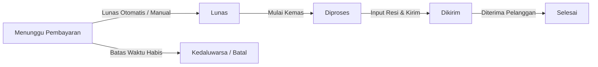

# Panduan Operasional Admin & Owner — BloomingKembang

Selamat datang di panel administrasi **BloomingKembang**! Panduan ini dirancang untuk pemilik toko (*owner*), tim gudang, dan staf operasional dalam mengelola katalog, inventaris, pesanan, promosi, dan konten harian.

---

## 1. Akses & Keamanan Akun Admin

- **URL Panel Admin**: `https://bloomingkembang.com/admin`
- **Kredensial Default (Demo)**:
  - Email: `admin@bloomingkembang.com`
  - Password: `password`
- **Tips Keamanan**:
  1. Segera ubah password default setelah login pertama kali di menu profil pojok kanan atas.
  2. Jangan membagikan akun `super_admin` kepada staf operasional harian.
  3. Gunakan role `warehouse_staff` untuk staf pengepakan dan pengiriman barang.

---

## 2. Manajemen Produk & Varian

### Menambah Produk Baru
1. Buka menu **Katalog** &rarr; **Produk** &rarr; klik tombol **Tambah Produk**.
2. **Tab Informasi Utama**:
   - Masukkan **Nama Produk** (contoh: *Pashmina Silk Premium - Rose Mauve*). Slug akan terisi otomatis.
   - Pilih **Kategori** (misal: *Pashmina*, *Segi Empat*, *Khimar*).
   - Masukkan **Bahan** (misal: *100% Pure Mulberry Silk & Ceruty Babydoll*) dan **Dimensi** (*180 x 75 cm*).
   - Isi **Deskripsi Lengkap** dan **Panduan Perawatan** (cuci dengan tangan, jemur di tempat teduh).
3. **Tab Galeri & Foto**:
   - Unggah foto utama beresolusi tinggi (rasio 4:3 atau 1:1, format JPG/WebP).
   - Unggah foto pendukung untuk memperlihatkan tekstur kain dan detail jahitan tepi.
4. **Tab Varian & Stok**:
   - Tambahkan varian warna (contoh: *Dusty Mauve*, *Soft Sage*, *Burgundy*).
   - Masukkan kode warna Hex (misal: `#C48B9F`), SKU unik (misal: `BK-PSH-ROSE-01`), harga jual, berat barang (gram), dan jumlah stok awal.
5. Klik **Simpan** & pastikan toggle **Publikasikan** aktif agar produk tampil di katalog storefront.

---

## 3. Alur Pemrosesan Pesanan (Order Fulfillment)

Setiap pesanan pelanggan memiliki siklus status yang terdata di menu **Pesanan**:

### Langkah Memproses Pesanan Baru:
1. Buka menu **Pesanan** & filter status **Lunas (Paid)**.
2. Klik tombol **Lihat Detail** pada pesanan yang ingin diproses.
3. Cetak dokumen pengiriman:
   - Klik **Cetak Invoice PDF**: Sebagai lampiran bukti transaksi pelanggan di dalam paket.
   - Klik **Cetak Label Pengiriman PDF**: Tempelkan pada amplop/box pengiriman (berisi nama penerima, alamat lengkap, telepon, dan daftar SKU barang).
4. Ubah status pesanan menjadi **Diproses (Processing)** saat barang diserahkan ke bagian packing.
5. Setelah diserahkan ke kurir (JNE, SiCepat, J&T):
   - Ubah status menjadi **Dikirim (Shipped)**.
   - Masukkan **Kurir** dan **Nomor Resi Pengiriman**.
   - Sistem akan otomatis mengirimkan email konfirmasi pengiriman beserta nomor resi kepada pelanggan.

---

## 4. Manajemen Diskon & Voucher Promo

Buka menu **Promosi** &rarr; **Voucher**:
1. Klik **Tambah Voucher**.
2. Masukkan **Kode Kupon** (contoh: `RAMADHAN20`, `DISKONMEMBER`).
3. Pilih Tipe Diskon:
   - **Persentase**: Potongan % (misal `15%`, bisa diatur maksimal nominal potongan).
   - **Nominal Tetap**: Potongan langsung (misal `Rp 25.000`).
4. Atur **Minimal Pembelian**: Misal minimal belanja `Rp 150.000`.
5. Tentukan **Batas Pemakaian**:
   - Total kuota keseluruhan (misal `100` pemakaian pertama).
   - Kuota per akun pelanggan (misal `1` kali per user).
6. Tentukan tanggal **Mulai Berlaku** dan **Kedaluwarsa**.

---

## 5. Mengelola Banner Promo & Halaman Kebijakan

### Mengganti Banner Beranda (Hero Slider)
1. Buka menu **Konten Web** &rarr; **Banner**.
2. Klik **Tambah Banner**:
   - Unggah gambar banner beranda (rekomendasi dimensi: `1920 x 800` px).
   - Masukkan judul banner (misal: *Elegansi Bersahaja Koleksi Eid Mubarak*).
   - Masukkan tautan tombol CTA (misal: `/koleksi/pashmina`).
   - Tentukan urutan tampil dan aktifkan toggle status.

### Mengedit Halaman Statis (Tentang Kami, FAQ, Kebijakan Retur)
1. Buka menu **Konten Web** &rarr; **Halaman Statis**.
2. Pilih halaman yang ingin disunting (misal: *Kebijakan Retur & Garansi*).
3. Gunakan visual Rich Editor untuk mengubah nomor kontak layanan retur, ketentuan syarat garansi, dan estimasi waktu penanganan.
4. Perubahan akan langsung tayang di `/kebijakan-retur`.

---

## 6. Kelola Pengguna & Staf

Buka menu **Pengaturan** &rarr; **Pengguna**:
- **Super Admin**: Akses penuh ke seluruh konfigurasi sistem, pembayaran, dan penghapusan data.
- **Admin**: Akses operasional katalog, order, voucher, dan laporan penjualan.
- **Warehouse Staff**: Akses khusus untuk melihat order lunas, mencetak label & invoice, dan menginput nomor resi pengiriman.
